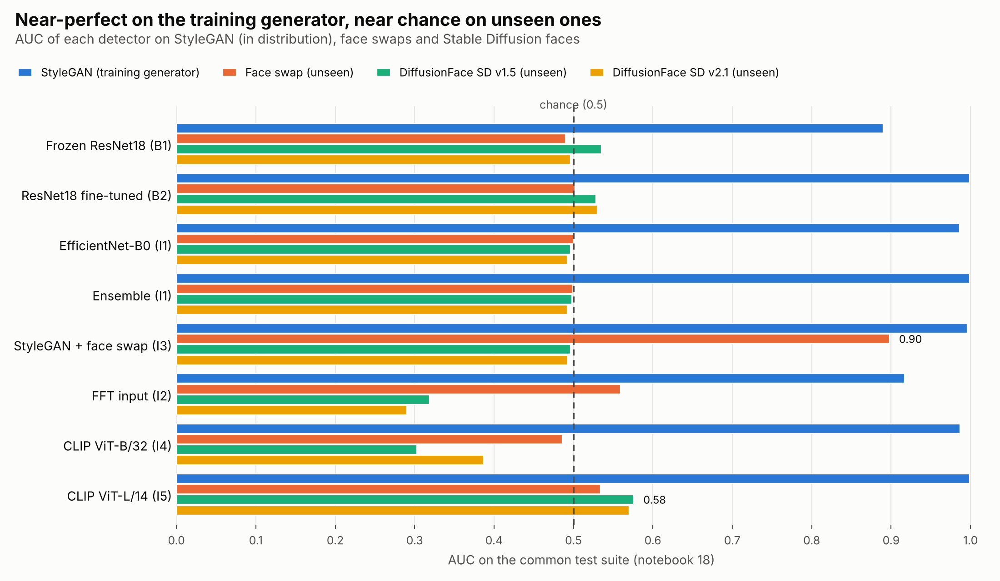

# Deepfake Detection Across Generators: Generalization and Reliability of AI-Generated Face Detectors

**TL;DR.** A ResNet18 fine-tuned on StyleGAN faces reaches AUC 0.999 on the generator it was trained on,
but stays at chance (AUC ≈ 0.50) on face swaps and Stable Diffusion faces. Ensembles, frequency inputs and
frozen CLIP backbones do not close the gap. Every result is checked with seeds, confidence intervals, a
shortcut audit, a leakage check, everyday degradations and adversarial attacks.

Code and results of a Master 2 thesis (Professional Master in Artificial Intelligence, Lebanese University,
Faculty of Sciences, 2026) on **single-image detection of AI-generated faces**.

📄 **Thesis:** [`thesis/Thesis.pdf`](thesis/Thesis.pdf) · 📊 **Results report:** [`results/Final_Results_Report.pdf`](results/Final_Results_Report.pdf)



The thesis asks a simple question: a detector that is almost perfect on the generator it was trained on,
how does it behave on generators it has never seen, and how much can the reported numbers be trusted?

Three forgery families are studied, each with one public dataset:

- **StyleGAN** faces (fully generated), used for training and for the in-distribution test;
- **face swaps** (a GAN-synthesized face blended into a real photograph);
- **Stable Diffusion** faces (DiffusionFace, SD v1.5 and v2.1).

The main model is a ResNet18 fine-tuned on StyleGAN faces. It is compared with EfficientNet-B0,
a frequency-domain (FFT) model, and frozen CLIP backbones (ViT-B/32 and ViT-L/14).

## Research questions

Experiments are labelled as in the thesis: **B** = baseline, **G** = generalization, **I** = improvement
attempts, **R** = reliability and robustness.

| RQ | Question | Experiments |
|---|---|---|
| RQ1 | How well does a detector work in distribution, and what role does fine-tuning play? | B1, B2, B3 |
| RQ2 | What happens on generators not seen in training (face swaps, diffusion)? | G1, G2 |
| RQ3 | Can the gap be closed (ensemble, FFT input, mixed training, CLIP)? | I1 to I5 |
| RQ4 | How reliable are the conclusions (seeds, shortcuts, leakage, degradations, attacks)? | R1 to R5 |

## Main results

AUC of each model on the same frozen test subsets (5,000 + 5,000 images for StyleGAN and
face swaps; 3,000 + 3,000 for DiffusionFace, with its own real images). 0.50 is chance.
Produced by notebook `18_common_test_suite`.

| Model | Basis | StyleGAN | Face swap | DiffusionFace SD v1.5 | DiffusionFace SD v2.1 |
|---|---|---|---|---|---|
| B1: frozen ResNet18 | single run | 0.890 | 0.490 | 0.535 | 0.496 |
| B2: ResNet18, layer4 fine-tuned | 3-seed mean | 0.999 | 0.502 | 0.528 | 0.530 |
| I1: EfficientNet-B0 | single run | 0.986 | 0.500 | 0.496 | 0.492 |
| I1: ensemble | single run | 0.999 | 0.499 | 0.498 | 0.492 |
| I2: frequency (FFT) input | single run | 0.917 | 0.559 | 0.319 | 0.290 |
| I3: StyleGAN + face swap | 3-seed mean | 0.996 | 0.898 | 0.496 | 0.493 |
| I4: CLIP ViT-B/32 + linear head | single run | 0.987 | 0.486 | 0.303 | 0.387 |
| I5: CLIP ViT-L/14 + linear head | single run | 0.999 | 0.534 | 0.576 | 0.570 |

**What the results show (in these experiments, on these datasets):**

- Near-perfect accuracy on the training generator (98.6% on average over three seeds) does
  not carry over: the same model is at chance on face swaps and on diffusion faces.
- An ensemble, a frequency-domain input and a frozen CLIP backbone do not close the gap.
  Training on face swaps raises face-swap AUC from 0.50 to 0.90, but only for face swaps,
  and costs about 1.6 points of accuracy on StyleGAN.
- The larger CLIP (ViT-L/14) is the only model slightly above chance on diffusion faces
  (AUC about 0.57). The signal is weak and was measured with a single trained head.
- Some models fall **below** chance on diffusion faces (AUC 0.29 to 0.39): they rank
  diffusion fakes as more real than the real images.
- The main effects hold in every seed. A near-duplicate check of the face-swap split
  (0.9% of test images flagged) leaves the I3 result unchanged.
- The undefended model tolerates moderate JPEG compression and blur but not strong blur or
  heavy downscaling, and a small white-box adversarial perturbation (epsilon = 0.01) drives
  its accuracy to 0%, also after 8-bit rounding and JPEG compression.

Conclusion of the thesis: accuracy on the training generator is not evidence of
generalization, and detectors should be evaluated on generators they have not seen.

## Notebooks

One notebook per experiment, named and numbered as in Appendix C of the thesis. Each notebook
opens in Google Colab from the badge at its top.

| Notebook | Label | What it does | Key result |
|---|---|---|---|
| `01_B1_frozen_baseline` | B1 | ResNet18, frozen backbone, linear probe | 80.8% accuracy, AUC 0.888 on StyleGAN |
| `02_B2_finetuning` | B2 | ResNet18 with `layer4` unfrozen | 98.8% accuracy, AUC 0.999 |
| `03_B3_ablation` | B3 | Separates the effect of unfreezing from the effect of the learning rate | unfreezing, not the learning rate, explains the gain |
| `04_G1_faceswap_transfer` | G1 | B1 and B2 tested on face swaps, no retraining | about 49 to 50% accuracy, AUC about 0.50 |
| `05_G2_diffusionface_transfer` | G2, R2 | RGB models on DiffusionFace (original and JPEG-75) and the DiffusionFace shortcut audit | AUC 0.44 to 0.53 (chance); file facts alone give AUC 0.80 / 0.73 |
| `06_I1_ensemble` | I1 | EfficientNet-B0 and probability-averaging ensemble | no improvement on unseen domains |
| `07_I2_frequency_domain` | I2 | ResNet18 trained on FFT spectra | 83.8% on StyleGAN |
| `08_I2_frequency_diffusionface` | I2, R2 | Frequency model on DiffusionFace | below chance (AUC 0.29 to 0.32) |
| `09_I3_mixed_source_training` | I3 | Training on StyleGAN + face swaps | face-swap AUC 0.90, StyleGAN accuracy 96.9% |
| `10_I4_clip_vitb32` | I4 | Frozen CLIP ViT-B/32 + linear head | 94.4% on StyleGAN, chance on face swaps |
| `11_I5_clip_vitl14` | I5 | CLIP ViT-L/14 and a ViT-B/32 re-run, final and intermediate layers | AUC 0.58 / 0.57 on DiffusionFace |
| `12_R1_seeds_and_confidence_intervals` | R1 | Seeds 0, 1, 2 and bootstrap confidence intervals | main effects hold in every seed |
| `13_R2_shortcut_confound_check` | R2 | File facts, pixel statistics, provenance classifier, normalization test | StyleGAN and face swap are clean (DiffusionFace audit: notebook 05) |
| `14_R3_near_duplicate_check` | R3 | Near-duplicate search between face-swap train and test (CLIP similarity) | 0.9% of test images flagged; I3 AUC unchanged |
| `15_R4_degradation_robustness` | R4 | JPEG, blur, resize, noise, combined "social media" pipeline | fails on strong blur and downscaling |
| `16_R5_adversarial_robustness` | R5 | FGSM and PGD attacks on B2 | 0% accuracy at epsilon = 0.01 |
| `17_R5_adversarial_jpeg_and_I3_controls` | R5, I3 | Attack after 8-bit rounding and JPEG; StyleGAN-only control runs | the attack survives; I3's StyleGAN cost comes from fewer StyleGAN images |
| `18_common_test_suite` | all | Scores every model on exactly the same test images | the table above |

**About the SD v1.4 dataset.** The project first used a Stable Diffusion v1.4 face dataset from Kaggle.
It contains only fake images, so real images had to be borrowed from the StyleGAN set, and the
shortcut check (R2) showed that **image size alone separates it from the real images (AUC 1.000)**.
A three-source model trained on it reached a diffusion AUC of 0.998, which was a shortcut and not
real detection. The dataset was therefore replaced by DiffusionFace, which has its own real images.
The two notebooks built around SD v1.4 are kept in [`notebooks/archive/`](notebooks/archive/), and notebooks
07, 10, 12, 13 and 15 still contain an SD v1.4 diffusion section, marked with a note at the top. Their
StyleGAN and face-swap results are unaffected. All diffusion results reported in the thesis come from DiffusionFace: notebooks 05 (transfer and the R2 shortcut audit), 08, 11 and 18 (common test suite, including the three-seed results used in R1).

## Datasets

| Dataset | Forgery type | Used for |
|---|---|---|
| [140k Real and Fake Faces](https://www.kaggle.com/datasets/xhlulu/140k-real-and-fake-faces) (Kaggle) | StyleGAN vs real FFHQ | training, validation, in-distribution test |
| [Deepfake and Real Images](https://www.kaggle.com/datasets/manjilkarki/deepfake-and-real-images) (Kaggle), derived from OpenForensics | face swap (GAN face blended into a real photo) | cross-domain test; training source in I3 |
| [DiffusionFace](https://github.com/Rapisurazurite/DiffFace) (Chen et al., 2024; [arXiv:2403.18471](https://arxiv.org/abs/2403.18471)) | Stable Diffusion v1.5 and v2.1 faces, with real CelebA-HQ images | test only |

## Repository structure

```
├── README.md
├── LICENSE
├── requirements.txt
├── assets/
│   └── results.png                 results chart shown above
├── thesis/
│   └── Thesis.pdf                  final thesis
├── results/
│   ├── Final_Results_Report.pdf    results report
│   └── Final_Results_Report.docx
└── notebooks/
    ├── 01_B1_frozen_baseline.ipynb … 18_common_test_suite.ipynb   (see the table above)
    └── archive/                    excluded SD v1.4 experiments
```

## How to reproduce

1. Open a notebook in Google Colab from its badge (a single T4 GPU is enough).
2. Create a free Kaggle account and an API token. **Never commit the token**: paste it when the
   notebook asks for it, or use Colab secrets.
3. Mount Google Drive. Trained checkpoints are saved to `My Drive/thesis_checkpoints/`,
   so later notebooks load earlier checkpoints without retraining. Notebook 17 also caches
   its datasets on Drive, so they are downloaded only once.
4. Run the notebooks in numerical order, `01` to `18`. Notebook 18 needs the checkpoints of all earlier ones.

Requirements: see [`requirements.txt`](requirements.txt) (Python, PyTorch and torchvision, Hugging Face
`transformers` for CLIP `openai/clip-vit-base-patch32` and `openai/clip-vit-large-patch14`, scikit-learn,
Pillow). Library versions of the Colab environment were not pinned, and the Kaggle datasets are maintained
by third parties, so exact numbers may differ slightly when rerun, especially for the single, unseeded runs.

## Limitations

- Each forgery type is represented by one public dataset; the face-swap data has
  undocumented processing and an undocumented train/test split.
- The diffusion evidence comes from Stable Diffusion v1.5 and v2.1, which are closely related.
- I1, I2, I4 and R5 are single runs; the CLIP heads were trained once, and re-training
  the small head changed its DiffusionFace AUC by 0.09 to 0.10.
- The alternatives to ResNet18 were not tuned, and training used almost no augmentation.
- No standard benchmark (FaceForensics++, Celeb-DF, DF40, GenImage) was used, so the
  numbers cannot be compared directly with published results.
- Only an undefended model was attacked, in a white-box setting.

## Future work

- Leave-one-generator-out training with more generators.
- A stronger CLIP test: several seeds for the linear head, lightweight adapters, training on
  more than one generator.
- Training with blur and JPEG augmentation, then repeating the cross-domain and robustness tests.
- Evaluation on standard benchmarks, and a face-swap split grouped by source photograph.
- Adversarial training and attacks that account for JPEG compression.

## Citation

```
EL Tahech, M. (2026). Deepfake Detection Across Generators: Generalization and Reliability
of AI-Generated Face Detectors. Master 2 thesis, Faculty of Sciences, Lebanese University.
Supervisor: Dr. Rami Tawil.
```

## License

The code is released under the [MIT License](LICENSE). The datasets keep their own licenses;
DiffusionFace is released under CC BY 4.0 for research use.
